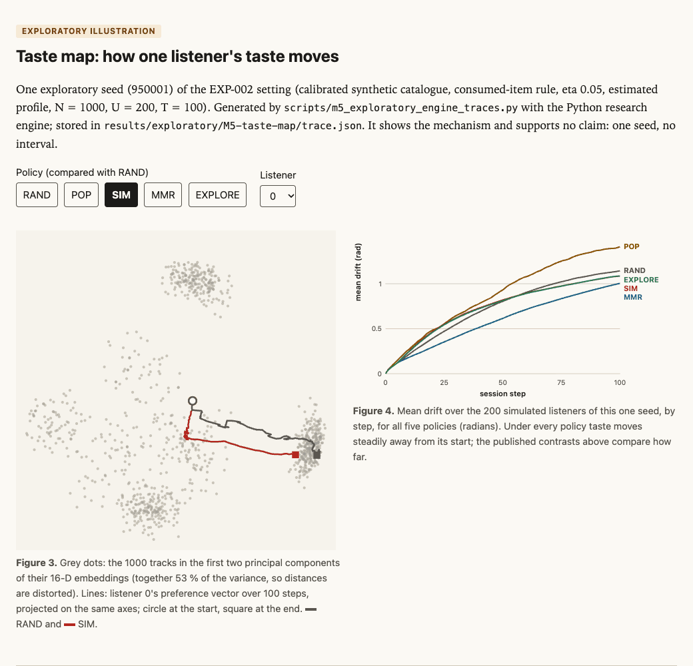

<!-- SPDX-License-Identifier: LicenseRef-ECHO-NC-Research-1.0 -->
# ECHO: music recommendation feedback

**Question.** Can recommendation policies change exposure and simulated taste rather than simply reflect it?

**Status: independent research manuscript / preprint draft, not peer-reviewed. Simulation only.** Protocol v1.0 was frozen by the owner on 2026-11-24 (`research/freeze.json`); all 560 confirmatory runs completed at revision afc0850. The owner approved the title, the authorship line and the funding, competing-interest and AI-assistance statements; the owner's full-text review of the manuscript is pending. The repository is public on GitHub; no release, tag, DOI or preprint exists yet.

Author: Mohamed Bechir Kefi, independent researcher.



## Why it matters

Recommenders decide what listeners hear. If what listeners hear also moves what they like, the system's training signal partly reflects its own past choices. ECHO studies this in a small, seeded simulation. It is not a claim about any real service or any real listener: simulated preference change is not evidence of human persuasion.

## Key findings (verified against committed results)

All values are SIM minus RAND differences in mean angular preference drift (rad), seed-paired, 95 % bootstrap CI over 10 seeds. They are identical to the manuscript (`research/paper/manuscript.md`, section 5).

- **EXP-002 (primary, synthetic catalogue calibrated on FMA metadata):** -0.0355 rad, CI [-0.0535, -0.0200]. Frozen decision: reject H0; whether the difference is practically relevant is unresolved.
- **EXP-003 (pre-registered sensitivity, 360 runs):** the interpretation is **withdrawn as assumption-dependent**. Under the bounded-confidence update rule at eta 0.05 the contrast was practically equivalent to zero (+0.0069 rad, CI [-0.0130, 0.0303]) or reversed with an oracle profile (+0.1883 rad, CI [0.1598, 0.2196]); the sign also changed with the update rate. The two readings of "practically equivalent" fixed in DEC-012 agree.
- **EXP-004 (second test on 4,951 real FMA tracks):** +0.1652 rad, CI [0.1560, 0.1735], the opposite sign: **does not replicate**.
- **Exposure (descriptive):** SIM concentrated exposure relative to RAND on both catalogues (exposure Gini +0.5118 [0.4883, 0.5336] and +0.6796 [0.6652, 0.6925]), largely by construction for a personalised top-k policy.

Within this model, the direction of simulated taste change is not a property of the policy alone; it depends on the update rule, the update rate and the catalogue geometry.

## Research navigation

| ID | Experiment | Status | Report |
|---|---|---|---|
| EXP-001 | Simulator verification and smoke matrix | exploratory; checks V1 to V6 pass | `research/experiments/EXP-001/report.md` |
| EXP-002 | Policy effect on simulated taste and exposure (primary) | confirmatory, 100 of 100 runs; reject H0, practical size unresolved | `research/experiments/EXP-002/report.md` |
| EXP-003 | Drift-assumption sensitivity and adaptation ablation | confirmatory, 360 of 360 runs; withdrawn as assumption-dependent | `research/experiments/EXP-003/report.md` |
| EXP-004 | Policy contrast on a real music catalogue (FMA), second test | confirmatory, 100 of 100 runs; does not replicate | `research/experiments/EXP-004/report.md` |

- Manuscript: `research/paper/manuscript.md` (supplementary appendix `research/paper/supplementary.md`). PDFs: `research/paper/manuscript.pdf` and `research/paper/supplementary.pdf`, built by `scripts/build_publication_pdfs.py`.
- Short report: `research/report.md`.
- Evidence trail: `research/claims_register.csv`, `research/publication/artifact_manifest.json`, `research/publication/claims_audit.md`, `research/publication/review_pass_2.md`.
- Decisions: `research/decision_log.md`. Limitations: `research/limitations.md`.
- Article drafts (not published): `articles/medium.md`, `articles/linkedin.md`.

## Interactive page (demo)

A static page in `demo/` shows the published results with their intervals, the assumptions, the method and limitations, an exploratory taste map drawn from the Python engine, and a sandbox that runs a port of the session loop in a Web Worker. It runs offline after the first load and sends nothing anywhere. Measured results, exploratory illustrations, sandbox output and assumptions are labelled separately.

```sh
cd demo && npm ci && npm run build && npm run preview
```

Then open the address `vite preview` prints. The page reads `demo/public/data/results.json`, written by `scripts/export_demo_data.py` from committed results only; it fails closed (shows no numbers) if that file is missing or malformed. Public demo: https://echo-recommender-feedback.kefimohamedbechir.workers.dev (static files only, hosted as Cloudflare Workers static assets; see `demo/README.md`).

## Quick start and reproduction

```sh
uv sync --frozen
PYTHONPATH=src uv run --frozen python -m echo.cli test
PYTHONPATH=src uv run --frozen python -m echo.cli smoke     # exploratory EXP-001, about 2 minutes
PYTHONPATH=src .venv/bin/python -m echo.analysis results/EXP-002 --planned 100 --kind policy   # re-derive an analysis from the committed runs
PYTHONPATH=src .venv/bin/python scripts/export_demo_data.py --check                            # demo data equals the committed results
```

`echo.cli run` runs a confirmatory config only if its SHA-256 and its protocol's SHA-256 match the freeze record and the registry; a changed config is refused. Exact commands for every experiment are in each report's reproduction appendix.

## Architecture

`src/echo`: catalogue and listener generation, policies, choice, preference updates, metrics, the session loop, the run guard, versioned result schema (`echo.result.v1`), run manifests and the analysis. `experiments/`: frozen configs. `results/`: committed runs, analyses and checksums. `demo/`: TypeScript, React and Vite, with the engine port in `demo/src/engine.ts`, tested against a fixture from the Python engine.

## Data

Listeners and listening are simulated. The synthetic catalogue is calibrated on FMA metadata (Defferrard et al., arXiv:1612.01840; CC BY 4.0): 16 genre clusters with fitted weights and a fitted Zipf exponent. EXP-004 uses real FMA tracks (audio features and play counts; no audio is downloaded). The FMA archive is not committed; `scripts/download_fma_metadata.py` and `scripts/build_fma_catalogue.py` rebuild it. Provenance and licences: `data/manifest.json`.

## Limitations

Simulated agents with assumed update rules; at eta 0.05 the drift outcome largely re-measures recent consumption; one real embedding of freely licensed music; 10 seeds per arm; a judgement-based smallest effect size of interest. See manuscript section 7 and `research/limitations.md`.

## Licence

The ECHO Source-Available Non-Commercial Research License v1.0 (`LICENSE`, SPDX `LicenseRef-ECHO-NC-Research-1.0`). It is source-available and is not an OSI open-source licence. Third-party material keeps its own terms (`NOTICE.md`).

## Citation

See `CITATION.cff`. Repository: https://github.com/mohamedbechirkefi/echo-recommender-feedback.
