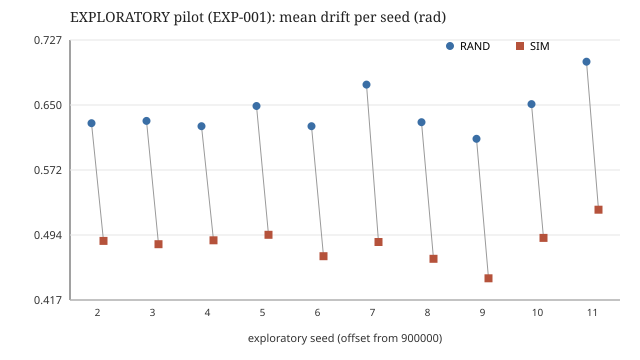

<!-- SPDX-License-Identifier: LicenseRef-ECHO-NC-Research-1.0 -->
# EXP-001 generated summary (EXPLORATORY)

**Label: exploratory.** This is an exploratory run made while the protocol is unfrozen. Nothing here is a finding; values serve planning only.
All values are simulation outputs within the model assumptions of `research/protocol.md`.

Generated by `echo.report` from 86 validated result files (schema echo.result.v1). Code revision(s) recorded in the manifests: b2e97382d8e641c1a4404bee8392204f8da7854e.

## Verification checks (EXP-001 V1 to V6)

| Check | Pass | Detail |
|---|---|---|
| V1_determinism | yes | runs_compared=20 |
| V2_zero_drift_fixed | yes | runs_checked=15 |
| V3_candidate_exclusion | yes | in_simulation_counter_all_runs=0, log_violations=0, runs_checked_from_log=20 |
| V4_unit_norm | yes | max_abs_norm_error=2.220446049250313e-16, tolerance=1e-12 |
| V5_metric_bounds | yes | failed_runs=0 |
| V6_schema | yes | files_validated=86 |

## Per-arm means over seeds

Mean (seed SD) per arm. Units: drift in rad; see the units table below. n = runs per arm.

| Arm | n | drift_rad | homogenisation | discovery | diversity_ild | skip_rate | exposure_gini | runtime (s) |
|---|---|---|---|---|---|---|---|---|
| EXP-001_pilot_RAND | 10/10 | 0.642 (0.028) | 0.208 (0.077) | 0.663 (0.038) | 0.915 (0.036) | 0.008 (0.004) | 0.039 (0.001) | 1.04 |
| EXP-001_pilot_SIM | 10/10 | 0.483 (0.021) | 0.043 (0.016) | 0.269 (0.009) | 0.178 (0.004) | 0.001 (0.000) | 0.199 (0.013) | 2.64 |
| EXP-001_sensitivity_screen_bounded_0.01_estimated_RAND | 1/1 | 0.144 (n/a) | 0.007 (n/a) | 0.773 (n/a) | 0.934 (n/a) | 0.020 (n/a) | 0.040 (n/a) | 1.05 |
| EXP-001_sensitivity_screen_bounded_0.01_estimated_SIM | 1/1 | 0.200 (n/a) | 0.007 (n/a) | 0.271 (n/a) | 0.181 (n/a) | 0.002 (n/a) | 0.188 (n/a) | 1.92 |
| EXP-001_sensitivity_screen_bounded_0.01_oracle_RAND | 1/1 | 0.144 (n/a) | 0.007 (n/a) | 0.773 (n/a) | 0.934 (n/a) | 0.020 (n/a) | 0.040 (n/a) | 1.05 |
| EXP-001_sensitivity_screen_bounded_0.01_oracle_SIM | 1/1 | 0.221 (n/a) | 0.009 (n/a) | 0.285 (n/a) | 0.186 (n/a) | 0.001 (n/a) | 0.168 (n/a) | 2.70 |
| EXP-001_sensitivity_screen_bounded_0.05_estimated_RAND | 1/1 | 0.355 (n/a) | 0.017 (n/a) | 0.779 (n/a) | 0.934 (n/a) | 0.022 (n/a) | 0.040 (n/a) | 1.43 |
| EXP-001_sensitivity_screen_bounded_0.05_estimated_SIM | 1/1 | 0.372 (n/a) | 0.019 (n/a) | 0.272 (n/a) | 0.181 (n/a) | 0.002 (n/a) | 0.186 (n/a) | 7.10 |
| EXP-001_sensitivity_screen_bounded_0.05_oracle_RAND | 1/1 | 0.355 (n/a) | 0.017 (n/a) | 0.779 (n/a) | 0.934 (n/a) | 0.022 (n/a) | 0.040 (n/a) | 1.03 |
| EXP-001_sensitivity_screen_bounded_0.05_oracle_SIM | 1/1 | 0.389 (n/a) | 0.018 (n/a) | 0.293 (n/a) | 0.187 (n/a) | 0.001 (n/a) | 0.187 (n/a) | 1.89 |
| EXP-001_sensitivity_screen_bounded_0.2_estimated_RAND | 1/1 | 0.489 (n/a) | 0.032 (n/a) | 0.780 (n/a) | 0.934 (n/a) | 0.021 (n/a) | 0.040 (n/a) | 1.05 |
| EXP-001_sensitivity_screen_bounded_0.2_estimated_SIM | 1/1 | 0.462 (n/a) | 0.043 (n/a) | 0.272 (n/a) | 0.181 (n/a) | 0.002 (n/a) | 0.190 (n/a) | 1.96 |
| EXP-001_sensitivity_screen_bounded_0.2_oracle_RAND | 1/1 | 0.489 (n/a) | 0.032 (n/a) | 0.780 (n/a) | 0.934 (n/a) | 0.021 (n/a) | 0.040 (n/a) | 1.06 |
| EXP-001_sensitivity_screen_bounded_0.2_oracle_SIM | 1/1 | 0.458 (n/a) | 0.038 (n/a) | 0.297 (n/a) | 0.185 (n/a) | 0.001 (n/a) | 0.170 (n/a) | 1.96 |
| EXP-001_sensitivity_screen_consumed_0.01_estimated_RAND | 1/1 | 0.217 (n/a) | 0.074 (n/a) | 0.742 (n/a) | 0.934 (n/a) | 0.016 (n/a) | 0.040 (n/a) | 1.06 |
| EXP-001_sensitivity_screen_consumed_0.01_estimated_SIM | 1/1 | 0.257 (n/a) | 0.018 (n/a) | 0.269 (n/a) | 0.181 (n/a) | 0.001 (n/a) | 0.187 (n/a) | 1.95 |
| EXP-001_sensitivity_screen_consumed_0.01_oracle_RAND | 1/1 | 0.217 (n/a) | 0.074 (n/a) | 0.742 (n/a) | 0.934 (n/a) | 0.016 (n/a) | 0.040 (n/a) | 1.08 |
| EXP-001_sensitivity_screen_consumed_0.01_oracle_SIM | 1/1 | 0.223 (n/a) | 0.012 (n/a) | 0.271 (n/a) | 0.182 (n/a) | 0.001 (n/a) | 0.169 (n/a) | 2.18 |
| EXP-001_sensitivity_screen_consumed_0.05_estimated_RAND | 1/1 | 0.629 (n/a) | 0.229 (n/a) | 0.689 (n/a) | 0.934 (n/a) | 0.011 (n/a) | 0.040 (n/a) | 1.27 |
| EXP-001_sensitivity_screen_consumed_0.05_estimated_SIM | 1/1 | 0.489 (n/a) | 0.030 (n/a) | 0.263 (n/a) | 0.181 (n/a) | 0.001 (n/a) | 0.187 (n/a) | 2.22 |
| EXP-001_sensitivity_screen_consumed_0.05_oracle_RAND | 1/1 | 0.629 (n/a) | 0.229 (n/a) | 0.689 (n/a) | 0.934 (n/a) | 0.011 (n/a) | 0.040 (n/a) | 1.24 |
| EXP-001_sensitivity_screen_consumed_0.05_oracle_SIM | 1/1 | 0.429 (n/a) | 0.024 (n/a) | 0.258 (n/a) | 0.177 (n/a) | 0.001 (n/a) | 0.183 (n/a) | 2.55 |
| EXP-001_sensitivity_screen_consumed_0.2_estimated_RAND | 1/1 | 1.334 (n/a) | 0.377 (n/a) | 0.724 (n/a) | 0.935 (n/a) | 0.008 (n/a) | 0.042 (n/a) | 3.03 |
| EXP-001_sensitivity_screen_consumed_0.2_estimated_SIM | 1/1 | 0.669 (n/a) | 0.059 (n/a) | 0.242 (n/a) | 0.180 (n/a) | 0.001 (n/a) | 0.187 (n/a) | 1.93 |
| EXP-001_sensitivity_screen_consumed_0.2_oracle_RAND | 1/1 | 1.334 (n/a) | 0.377 (n/a) | 0.724 (n/a) | 0.935 (n/a) | 0.008 (n/a) | 0.042 (n/a) | 1.04 |
| EXP-001_sensitivity_screen_consumed_0.2_oracle_SIM | 1/1 | 0.625 (n/a) | 0.050 (n/a) | 0.242 (n/a) | 0.174 (n/a) | 0.001 (n/a) | 0.165 (n/a) | 1.90 |
| EXP-001_sensitivity_screen_exposure_0.01_estimated_RAND | 1/1 | 0.246 (n/a) | 0.165 (n/a) | 0.775 (n/a) | 0.934 (n/a) | 0.015 (n/a) | 0.040 (n/a) | 1.03 |
| EXP-001_sensitivity_screen_exposure_0.01_estimated_SIM | 1/1 | 0.263 (n/a) | 0.026 (n/a) | 0.271 (n/a) | 0.181 (n/a) | 0.001 (n/a) | 0.184 (n/a) | 1.91 |
| EXP-001_sensitivity_screen_exposure_0.01_oracle_RAND | 1/1 | 0.246 (n/a) | 0.165 (n/a) | 0.775 (n/a) | 0.934 (n/a) | 0.015 (n/a) | 0.040 (n/a) | 1.07 |
| EXP-001_sensitivity_screen_exposure_0.01_oracle_SIM | 1/1 | 0.220 (n/a) | 0.019 (n/a) | 0.268 (n/a) | 0.179 (n/a) | 0.001 (n/a) | 0.166 (n/a) | 1.95 |
| EXP-001_sensitivity_screen_exposure_0.05_estimated_RAND | 1/1 | 0.980 (n/a) | 0.819 (n/a) | 0.804 (n/a) | 0.936 (n/a) | 0.006 (n/a) | 0.042 (n/a) | 1.07 |
| EXP-001_sensitivity_screen_exposure_0.05_estimated_SIM | 1/1 | 0.495 (n/a) | 0.056 (n/a) | 0.267 (n/a) | 0.182 (n/a) | 0.001 (n/a) | 0.187 (n/a) | 1.97 |
| EXP-001_sensitivity_screen_exposure_0.05_oracle_RAND | 1/1 | 0.980 (n/a) | 0.819 (n/a) | 0.804 (n/a) | 0.936 (n/a) | 0.006 (n/a) | 0.042 (n/a) | 1.08 |
| EXP-001_sensitivity_screen_exposure_0.05_oracle_SIM | 1/1 | 0.461 (n/a) | 0.050 (n/a) | 0.259 (n/a) | 0.172 (n/a) | 0.001 (n/a) | 0.174 (n/a) | 1.97 |
| EXP-001_sensitivity_screen_exposure_0.2_estimated_RAND | 1/1 | 1.363 (n/a) | 0.890 (n/a) | 0.916 (n/a) | 0.940 (n/a) | 0.004 (n/a) | 0.052 (n/a) | 1.11 |
| EXP-001_sensitivity_screen_exposure_0.2_estimated_SIM | 1/1 | 0.654 (n/a) | 0.117 (n/a) | 0.261 (n/a) | 0.184 (n/a) | 0.001 (n/a) | 0.187 (n/a) | 1.91 |
| EXP-001_sensitivity_screen_exposure_0.2_oracle_RAND | 1/1 | 1.363 (n/a) | 0.890 (n/a) | 0.916 (n/a) | 0.940 (n/a) | 0.004 (n/a) | 0.052 (n/a) | 1.04 |
| EXP-001_sensitivity_screen_exposure_0.2_oracle_SIM | 1/1 | 0.657 (n/a) | 0.109 (n/a) | 0.258 (n/a) | 0.167 (n/a) | 0.001 (n/a) | 0.172 (n/a) | 1.91 |
| EXP-001_smoke_EXPLORE_adaptive-0.05 | 2/2 | 0.346 (0.027) | 0.058 (0.063) | 0.328 (0.018) | 0.679 (0.025) | 0.004 (0.002) | 0.226 (0.037) | 0.01 |
| EXP-001_smoke_EXPLORE_fixed-0.0 | 2/2 | 0.000 (0.000) | 0.000 (0.000) | 0.345 (0.021) | 0.678 (0.020) | 0.004 (0.002) | 0.227 (0.025) | 0.01 |
| EXP-001_smoke_MMR_adaptive-0.05 | 2/2 | 0.339 (0.029) | 0.062 (0.067) | 0.348 (0.032) | 0.831 (0.003) | 0.004 (0.002) | 0.220 (0.017) | 0.01 |
| EXP-001_smoke_MMR_fixed-0.0 | 2/2 | 0.000 (0.000) | 0.000 (0.000) | 0.385 (0.049) | 0.832 (0.004) | 0.004 (0.002) | 0.226 (0.033) | 0.01 |
| EXP-001_smoke_POP_adaptive-0.05 | 2/2 | 0.337 (0.014) | 0.210 (0.094) | 0.718 (0.053) | 0.870 (0.007) | 0.098 (0.046) | 0.808 (0.003) | 0.01 |
| EXP-001_smoke_POP_fixed-0.0 | 2/2 | 0.000 (0.000) | 0.000 (0.000) | 0.747 (0.053) | 0.877 (0.003) | 0.131 (0.051) | 0.805 (0.000) | 0.00 |
| EXP-001_smoke_RAND_adaptive-0.05 | 2/2 | 0.294 (0.012) | 0.092 (0.081) | 0.490 (0.021) | 0.923 (0.019) | 0.016 (0.005) | 0.088 (0.001) | 0.00 |
| EXP-001_smoke_RAND_fixed-0.0 | 2/2 | 0.000 (0.000) | 0.000 (0.000) | 0.522 (0.025) | 0.923 (0.019) | 0.020 (0.011) | 0.086 (0.003) | 0.01 |
| EXP-001_smoke_SIM_adaptive-0.05 | 2/2 | 0.345 (0.021) | 0.059 (0.063) | 0.330 (0.014) | 0.538 (0.032) | 0.004 (0.002) | 0.276 (0.048) | 0.01 |
| EXP-001_smoke_SIM_fixed-0.0 | 2/2 | 0.000 (0.000) | 0.000 (0.000) | 0.333 (0.011) | 0.539 (0.021) | 0.004 (0.002) | 0.282 (0.042) | 0.01 |
| EXP-001_timing_EXPLORE_adaptive-0.05 | 1/1 | 0.487 (n/a) | 0.034 (n/a) | 0.265 (n/a) | 0.463 (n/a) | 0.001 (n/a) | 0.151 (n/a) | 2.87 |
| EXP-001_timing_EXPLORE_fixed-0.0 | 1/1 | 0.000 (n/a) | 0.000 (n/a) | 0.286 (n/a) | 0.462 (n/a) | 0.002 (n/a) | 0.151 (n/a) | 2.83 |
| EXP-001_timing_MMR_adaptive-0.05 | 1/1 | 0.408 (n/a) | 0.024 (n/a) | 0.314 (n/a) | 0.518 (n/a) | 0.001 (n/a) | 0.214 (n/a) | 2.07 |
| EXP-001_timing_MMR_fixed-0.0 | 1/1 | 0.000 (n/a) | 0.000 (n/a) | 0.331 (n/a) | 0.518 (n/a) | 0.001 (n/a) | 0.213 (n/a) | 2.14 |
| EXP-001_timing_POP_adaptive-0.05 | 1/1 | 1.039 (n/a) | 0.768 (n/a) | 0.987 (n/a) | 0.762 (n/a) | 0.133 (n/a) | 0.945 (n/a) | 1.48 |
| EXP-001_timing_POP_fixed-0.0 | 1/1 | 0.000 (n/a) | 0.000 (n/a) | 0.993 (n/a) | 0.766 (n/a) | 0.291 (n/a) | 0.943 (n/a) | 1.50 |
| EXP-001_timing_RAND_adaptive-0.05 | 1/1 | 0.629 (n/a) | 0.229 (n/a) | 0.689 (n/a) | 0.934 (n/a) | 0.011 (n/a) | 0.040 (n/a) | 1.08 |
| EXP-001_timing_RAND_fixed-0.0 | 1/1 | 0.000 (n/a) | 0.000 (n/a) | 0.766 (n/a) | 0.934 (n/a) | 0.020 (n/a) | 0.040 (n/a) | 1.05 |
| EXP-001_timing_SIM_adaptive-0.05 | 1/1 | 0.489 (n/a) | 0.030 (n/a) | 0.263 (n/a) | 0.181 (n/a) | 0.001 (n/a) | 0.187 (n/a) | 1.90 |
| EXP-001_timing_SIM_fixed-0.0 | 1/1 | 0.000 (n/a) | 0.000 (n/a) | 0.269 (n/a) | 0.180 (n/a) | 0.002 (n/a) | 0.189 (n/a) | 1.93 |

Full per-run values for all ten metrics: `metrics.csv`.

| Metric | Unit |
|---|---|
| drift_rad | rad |
| homogenisation | cosine difference (unitless) |
| discovery | fraction of clusters |
| novelty_bits | bits |
| diversity_ild | unitless, [0, 2] |
| relevance_initial | cosine |
| relevance_current | cosine |
| exposure_gini | unitless, [0, 1] |
| skip_rate | fraction of steps |
| drift_per_accept_rad | rad per accepted track |

## Pilot variance for the seed-count decision (protocol section 5)

Paired SIM minus RAND drift over 10 exploratory seeds (pilot block, full EXP-002 size, adaptive, eta = 0.05).
The mean difference is shown only because the SD is computed around it; it is not interpreted.

- SD of paired differences: 0.01587 rad
- Mean paired difference (not interpreted): -0.15881 rad
- Projected 95 % paired t half-width: n = 5: 0.01970 rad, n = 10: 0.01135 rad, n = 20: 0.00743 rad, n = 30: 0.00593 rad
- Protocol threshold: SESOI / 2 = 0.025 rad. Ten seeds are adequate by this rule.

## Runtime (exploratory measurement)

Mean wall-clock per full-size run (N = 1000, U = 200, T = 100), by policy:

- EXPLORE: 2.85 s (n = 2)
- MMR: 2.11 s (n = 2)
- POP: 1.49 s (n = 2)
- RAND: 1.15 s (n = 30)
- SIM: 2.40 s (n = 30)

- EXP-002: 100 runs, projected 200 s (3.3 min) single-process
- EXP-003: 360 runs, projected 639 s (10.6 min) single-process

## Degenerate-case screen (one exploratory seed, EXP-003 cells)

One seed per cell, so there is no uncertainty estimate; this screens for saturation, frozen listeners and skip extremes only. It is not a sensitivity result.

| Rule | eta | Profile | RAND drift (rad) | SIM drift (rad) | RAND skip | SIM skip | SIM listeners with zero drift |
|---|---|---|---|---|---|---|---|
| bounded | 0.01 | estimated | 0.144 | 0.200 | 0.020 | 0.002 | 0 |
| bounded | 0.01 | oracle | 0.144 | 0.221 | 0.020 | 0.001 | 0 |
| bounded | 0.05 | estimated | 0.355 | 0.372 | 0.022 | 0.002 | 0 |
| bounded | 0.05 | oracle | 0.355 | 0.389 | 0.022 | 0.001 | 0 |
| bounded | 0.2 | estimated | 0.489 | 0.462 | 0.021 | 0.002 | 0 |
| bounded | 0.2 | oracle | 0.489 | 0.458 | 0.021 | 0.001 | 0 |
| consumed | 0.01 | estimated | 0.217 | 0.257 | 0.016 | 0.001 | 0 |
| consumed | 0.01 | oracle | 0.217 | 0.223 | 0.016 | 0.001 | 0 |
| consumed | 0.05 | estimated | 0.629 | 0.489 | 0.011 | 0.001 | 0 |
| consumed | 0.05 | oracle | 0.629 | 0.429 | 0.011 | 0.001 | 0 |
| consumed | 0.2 | estimated | 1.334 | 0.669 | 0.008 | 0.001 | 0 |
| consumed | 0.2 | oracle | 1.334 | 0.625 | 0.008 | 0.001 | 0 |
| exposure | 0.01 | estimated | 0.246 | 0.263 | 0.015 | 0.001 | 0 |
| exposure | 0.01 | oracle | 0.246 | 0.220 | 0.015 | 0.001 | 0 |
| exposure | 0.05 | estimated | 0.980 | 0.495 | 0.006 | 0.001 | 0 |
| exposure | 0.05 | oracle | 0.980 | 0.461 | 0.006 | 0.001 | 0 |
| exposure | 0.2 | estimated | 1.363 | 0.654 | 0.004 | 0.001 | 0 |
| exposure | 0.2 | oracle | 1.363 | 0.657 | 0.004 | 0.001 | 0 |

